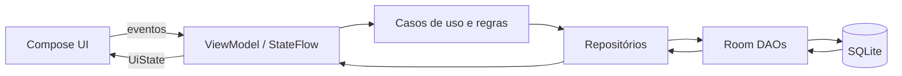

# Arquitetura Proposta

Arquitetura técnica consolidada: Kotlin, Compose Material 3, Room, Navigation Compose, ViewModel, StateFlow e Coroutines. Recomenda-se um único módulo `:app`, sem módulos extras até haver necessidade comprovada; injeção manual por composição é suficiente inicialmente, sem DI externo. Esta composição será aplicada somente após a aprovação do planejamento.

| Camada | Responsabilidade |
|---|---|
| UI | Exibir `UiState`, acessibilidade, coletar entradas e navegar; não calcular totais. |
| ViewModel | Estado, eventos, coroutines, carregamento/erro/vazio. |
| Casos de uso | Aplicar RN-001 a RN-012, validações e transações. |
| Repositórios | Contrato de dados e mapeamento domínio/persistência. |
| Room | Entidades, relações, DAOs, consultas e migrações. |

Estados assíncronos: carregando, conteúdo, vazio e erro recuperável. Nenhuma camada depende de rede.

