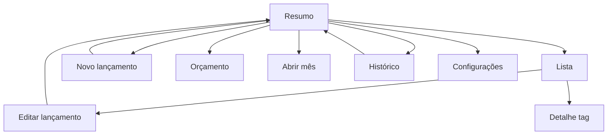

# Especificação de UI/UX

## Telas
| Área | Objetivo e ações | Vazio/erro/validação |
|---|---|---|
| Resumo mensal | Mostrar totais, distribuição, trocar mês e abrir lançamento/orçamento. | Sem orçamento: CTA configurar; sem gastos: total zero; erro: tentar novamente. |
| Novo/editar lançamento | Descrição, valor, data, chips opcionais de tags e salvar/excluir; criar ou reutilizar tag no próprio formulário. | Descrição/valor inválidos em campo; nenhuma tag é exigida; tags duplicadas são ignoradas. |
| Lista | Pesquisar, filtrar por mês/período/tag ou por lançamentos sem tag, editar e excluir confirmado. | Sem resultados com opção de limpar filtros; lançamentos sem tags continuam na lista geral. |
| Detalhe da tag | Total de associações, lançamentos classificados e ação para renomear/excluir. | Antes de excluir, informar a quantidade de classificações removidas e confirmar; não há hierarquia. |
| Orçamento | Criar ou editar o único orçamento do mês. | Valor inválido; esclarecer que gastos permanecem. |
| Abrir mês | Exibir mês e sugestão editável, confirmar explicitamente. | Sem anterior: sem sugestão. |
| Histórico | Listar meses com orçamento, gasto e saldo. | Sem meses: orientar a criar orçamento. |
| Configurações | Apenas informações de privacidade/offline e versão. | Sem opções de backup ou rede na v1. |

Todos os controles têm rótulos semânticos, área de toque adequada, contraste Material 3, suporte a escala de fonte e não usam cor como único indicador.

